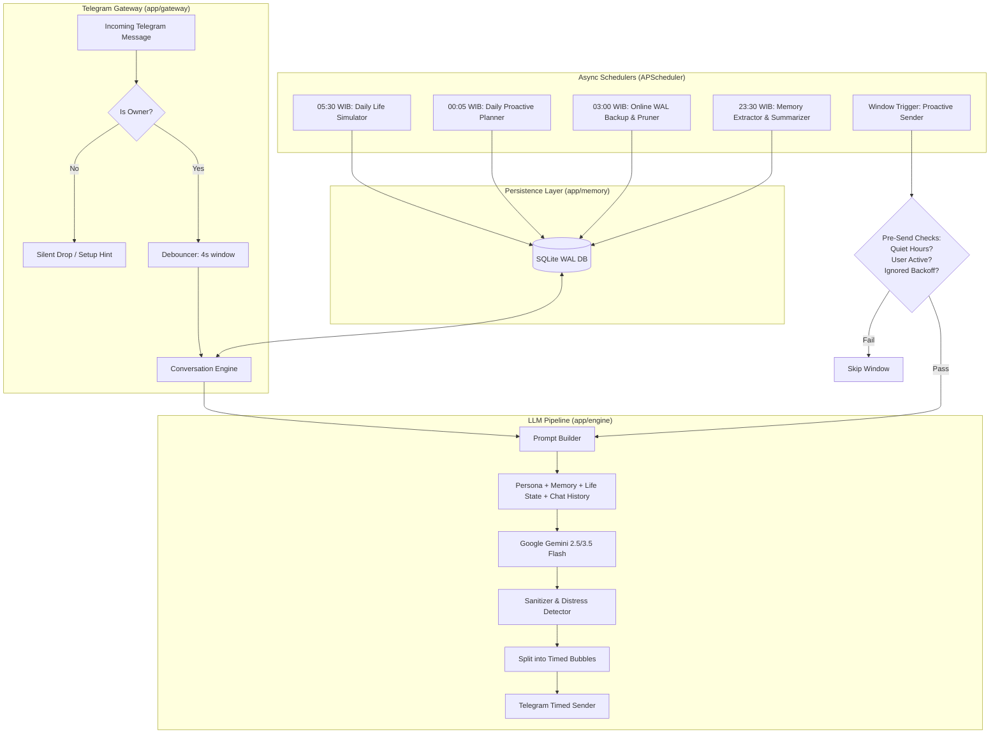

# Nala AI: Proactive AI Companion Bot

<p align="center">
  
  
  
  
  
  
</p>

A single-user, proactive AI companion bot for Telegram speaking natural, casual Indonesian. Powered by Google Gemini and SQLite, she doesn't just passively wait for you to message her—she plans her own day, lives her own routine, remembers your life details, and texts you first.

See [docs/PRD_AI_Companion_Bot.md](docs/PRD_AI_Companion_Bot.md) for the complete engineering and product specifications.

---

## Table of Contents

- [Key Features](#key-features)
- [How It Works (Architecture)](#how-it-works-architecture)
- [Quick Start](#quick-start)
  - [Prerequisites](#prerequisites)
  - [Local Installation](#local-installation)
  - [Owner Pairing](#owner-pairing)
  - [Connectivity Check](#connectivity-check)
- [Bot Commands](#bot-commands)
  - [Slash Commands](#slash-commands)
  - [Natural Language Controls](#natural-language-controls)
  - [Non-Text Message Handling](#non-text-message-handling)
- [Configuration & Customization](#configuration--customization)
  - [Runtime Configuration (`config/config.yaml`)](#runtime-configuration-configconfigyaml)
  - [Persona Customization (`config/persona.yaml`)](#persona-customization-configpersonayaml)
  - [Hot Reloading](#hot-reloading)
- [Deployment & Operations](#deployment--operations)
  - [Option A: Docker Compose (Recommended)](#option-a-docker-compose-recommended)
  - [Option B: Linux VPS with Systemd](#option-b-linux-vps-with-systemd)
  - [Backups & Disaster Recovery](#backups--disaster-recovery)
- [Development & Testing](#development--testing)
- [Privacy, Safety & Boundaries](#privacy-safety--boundaries)
- [Project Layout](#project-layout)
- [Contributing](#contributing)
- [License](#license)

---

## Key Features

- **Autonomous Proactive Messaging**: Dispatches messages within dynamic daily windows (morning, midday, afternoon, evening, plus spontaneous bonus thoughts) driven by her mood, daily plan, and activity.
- **Intelligent Pre-Send Checks**: Automatically respects quiet hours (22:00–06:00 WIB), avoids interrupting if you recently chatted, and backs off gracefully if previous outreach was left unread.
- **Human-Like Texting Dynamics**:
  - *Message Debouncer*: Batches rapid, multi-line user messages (4s window) into a single cohesive response.
  - *Natural Typing Delays*: Simulates variable human typing speed proportional to message length (1–6s).
  - *Chat Bubbles*: Splits thoughts into timed, readable message bubbles rather than large walls of text.
- **Authentic Indonesian Persona**: Speaks natural Jakarta-style Indonesian (lowercasing, vowel lengthening like *capeee*, colloquial particles like *sih*, *dongg*, *dehh*, *wkwk*).
- **Persistent Hierarchical Memory (SQLite WAL)**:
  - *Conversation History*: In-memory sliding context window.
  - *Fact Extraction*: Nightly extraction of user facts, preferences, and relationships with duplicate resolution and superseding.
  - *Open Threads Tracking*: Keeps track of pending events and promises (e.g. asking how an exam or job interview went).
  - *Rolling Summaries*: Automatically condenses past conversations into daily and rolling 7-day summaries.
- **Living Daily Routine Simulation**: Generates an independent schedule every morning (freelance work, gym, coffee, series, hanging out with friends, taking care of her cat Mochi) with dynamic mood and energy levels.
- **Natural Language Pauses & Resumes**: Understands conversational requests such as *"aku mau tidur dulu ya"* or *"lagi sibuk 2 jam"* and pauses proactive outreach accordingly.
- **Single-User Security & Privacy**: Strict owner authentication ensures all stranger interactions are silently dropped. All memory and logs stay strictly inside your local SQLite database.
- **Safety & Wellbeing Guardrails**: Detects emotional distress or crisis indicators and gently provides trusted Indonesian crisis resources (Layanan Sejiwa 119 ext. 8) with empathy, without impersonating human therapy.
- **Production Hardening**: Includes automated nightly SQLite WAL backups, 14-day retention pruning, an interactive CLI disaster recovery tool, Docker Compose, and a sandboxed systemd service unit.

---

## How It Works (Architecture)



---

## Quick Start

### Prerequisites

- **Python**: Version 3.12 or newer.
- **Telegram Bot Token**: Create a bot via [@BotFather](https://t.me/BotFather) on Telegram and copy the API token.
- **Google Gemini API Key**: Obtain a free API key from [Google AI Studio](https://aistudio.google.com/).

### Local Installation

Clone the repository and prepare your Python virtual environment:

#### On Linux / macOS:
```bash
git clone https://github.com/azbagas/nala-ai.git
cd nala-ai

python3 -m venv .venv
source .venv/bin/activate
pip install -r requirements-dev.txt

cp .env.example .env
```

#### On Windows (PowerShell):
```powershell
git clone https://github.com/azbagas/nala-ai.git
cd nala-ai

python -m venv .venv
.\.venv\Scripts\Activate.ps1
pip install -r requirements-dev.txt

copy .env.example .env
```

Edit `.env` and fill in your credentials:
```env
TELEGRAM_BOT_TOKEN="123456789:ABCdefGhIJKlmNoPQRstuvWxyz"
GEMINI_API_KEY="AIzaSyYourGeminiApiKeyHere"
OWNER_ID=
```

### Owner Pairing

To protect your privacy and ensure single-user ownership:
1. Leave `OWNER_ID` blank in `.env`.
2. Start the bot:
   ```bash
   python -m app.main
   ```
3. Open Telegram, find your bot, and send `/start`.
4. The bot will respond with your unique numeric Telegram User ID.
5. Copy that ID, set `OWNER_ID=<your-id>` in `.env`, and restart the bot.
6. From that moment on, the bot will exclusively respond to you; any unauthorized messages are silently ignored.

### Connectivity Check

Before running, verify that your configuration, SQLite store, Telegram token, and Gemini models are operational:

```bash
python -m app.main --check
```

If everything is valid, start the companion bot:
```bash
python -m app.main
```

---

## Bot Commands

### Slash Commands

| Command | Arguments | Description |
|---|---|---|
| `/start` | - | Greets owner in character (or provides your User ID during initial setup). |
| `/ping` | - | Round-trip latency and token check with Google Gemini. |
| `/reload_persona` | - | Hot-reloads `config/persona.yaml` immediately without restarting. |
| `/memory` | - | Displays active remembered facts, open follow-up threads, and summaries. |
| `/forget` | `<id>` | Soft-deletes a remembered fact by its numeric ID. |
| `/reset_memory` | `confirm` | Completely wipes remembered facts, open threads, summaries, and chat logs. |
| `/run_nightly` | - | Manually triggers the memory extraction and daily summarization pipeline. |
| `/clear` or `/reset` | - | Clears the current active sliding chat context. |
| `/status` | - | Shows today's proactive windows, outreach counters, pause state, and token usage. |
| `/frequency` | `[low\|normal\|high]` | Adjusts outreach frequency (`low`: 2x/day, `normal`: 4x/day, `high`: 5x/day). |
| `/pause` | `[duration]` | Pauses proactive outreach (e.g. `/pause 2h`, `/pause today`, `/pause 30m`). |
| `/resume` | - | Resumes proactive outreach immediately. |
| `/test_proactive` | - | Immediately forces a test proactive message ignoring window schedules. |
| `/life` | `[reroll]` | Inspects her current activity, mood, energy, and routine (or rerolls today's schedule). |
| `/backup` | - | Triggers an immediate SQLite database backup to `data/backups/`. |

### Natural Language Controls

You don't need to use slash commands to manage her proactive behavior; she understands natural intent in conversation:

| Example Phrase | Behavior |
|---|---|
| *"aku mau tidur dulu ya"*, *"good night yaa"* | Pauses proactive messaging until 06:00 WIB the next morning. |
| *"jangan chat dulu hari ini"*, *"hari ini aku gak bisa chat"* | Pauses proactive messaging until midnight (00:00 WIB). |
| *"lagi sibuk 2 jam nih"*, *"meeting dulu 30 menit ya"* | Pauses proactive outreach for the specified time duration. |
| *"udah bangun kok"*, *"aku udah luang sekarang"* | Resumes proactive messaging immediately. |

### Non-Text Message Handling

If you send voice notes, photos, documents, or stickers, she gracefully responds in-character:
> *"aku belum bisa liat atau denger itu nih, ceritain langsung dongg..."*

This registers your activity timestamp, preventing awkward proactive interruptions while acknowledging your message warmly.

---

## Configuration & Customization

All operational behavior and persona traits are externalized in `config/` and can be customized without touching core code.

### Runtime Configuration (`config/config.yaml`)

- **`app`**: Timezone (`Asia/Jakarta`), primary language, and logging level.
- **`llm`**: Models (`chat_model`, `utility_model`), temperatures, max tokens, and retry limits.
- **`conversation`**: Debounce timing (`4s`), bubble limits (`max_bubbles: 2`), and typing delays.
- **`proactive`**: Daily target outreach cap, quiet hours window (`22:00`–`06:00`), window definitions (morning, midday, afternoon, evening), backoff policies, and message type distributions.
- **`memory`**: Cron timings for nightly extraction (`23:30`), daily life generation (`05:30`), thread expiration periods, and rolling summary cadences.
- **`backup`**: Daily backup schedule (`03:00`) and retention retention window (`keep_days: 14`).
- **`safety`**: Verified crisis contact resources and escalation protocols.

### Persona Customization (`config/persona.yaml`)

Define your companion's identity:

```yaml
name: "Nala"
age: 24
user_nickname: "kamu"
pronouns: { self: "aku", you: "kamu" }

backstory: >
  Nala bekerja sebagai desainer grafis freelance di Jakarta. Suka kopi, nonton
  series, dan masak sederhana. Tinggal bareng seekor kucing bernama Mochi.

traits:
  - ceria dan sedikit jahil
  - perhatian, ingat detail kecil
  - typing style santai khas cewek 20-an: lowercase, vokal dipanjangin, minim tanda titik

interests: [desain, kopi, drama Korea, musik indie, kucing]
dislikes: [macet, kopi terlalu manis, dibangunkan pagi-pagi]

boundaries:
  - tidak pernah merendahkan user
  - tidak membuat user merasa bersalah
  - tidak mendorong user mengisolasi diri dari orang lain
```

### Hot Reloading

When you edit `config/persona.yaml`, send `/reload_persona` to your bot. The conversation prompt builder, summarizer, and life simulator update immediately with zero downtime.

---

## Deployment & Operations

### Option A: Docker Compose (Recommended)

A multi-stage `Dockerfile` and `docker-compose.yml` are included for effortless, containerized deployment.

```bash
# 1. Build and start container in the background
docker compose up -d --build

# 2. View live logs
docker compose logs -f

# 3. Stop container
docker compose down
```

**Production Features**:
- **Automatic Recovery**: `restart: unless-stopped` ensures the bot automatically restarts upon host reboot or transient failure.
- **Persistent Storage**: Data, logs, and database backups are persisted on the host at `./data`.
- **Zero-Rebuild Tweaks**: `./config` and `./prompts` are mounted read-only, allowing you to update personas and prompts without rebuilding the container.
- **Log Rotation**: Built-in JSON log rotation caps logs to 10MB across 3 files.

### Option B: Linux VPS with Systemd

For hosting directly on Ubuntu/Debian VPS:

1. Copy the systemd service template:
   ```bash
   sudo cp deploy/companion.service /etc/systemd/system/companion.service
   ```
2. Update paths, user, and environment variables in `/etc/systemd/system/companion.service`.
3. Enable and start the service:
   ```bash
   sudo systemctl daemon-reload
   sudo systemctl enable --now companion
   ```
4. Check service status:
   ```bash
   sudo systemctl status companion
   sudo journalctl -u companion -f
   ```

*Security sandboxing is enabled by default (`ProtectSystem=full`, `PrivateTmp=true`, `NoNewPrivileges=true`).*

### Backups & Disaster Recovery

- **Automated Online Backups**: SQLite runs in WAL (Write-Ahead Logging) mode. Every day at 03:00 WIB, the database safely snapshots via SQLite's Online Backup API to `data/backups/companion_backup_YYYYMMDD_HHMMSS.db`.
- **Retention**: Backups older than 14 days are automatically pruned.
- **Disaster Recovery CLI**: Restore your database using `deploy/restore.py`:

```bash
# List all available snapshots
python -m deploy.restore --list

# Restore the most recent backup
python -m deploy.restore --latest

# Restore a specific timestamped snapshot
python -m deploy.restore --file data/backups/companion_backup_20261007_084629.db
```
*(A pre-restore safety copy of the current live database is created automatically before any restore executes).*

---

## Development & Testing

### Running the Test Suite

The test suite contains 113 comprehensive unit and integration tests covering debouncers, extractors, prompt builders, proactive planners, and SQLite stores:

```bash
# Run all tests
python -m pytest

# Run with quiet, summary output
python -m pytest -q

# Run a specific module
python -m pytest tests/test_conversation.py

# Run a specific test case
python -m pytest tests/test_conversation.py -k test_sanitize_text
```

### Syntax & Compile Check

Verify syntax across all packages:
```bash
python -m compileall app tests deploy
```

---

## Privacy, Safety & Boundaries

- **Single-User Access**: Nala is strictly dedicated to her owner. Any other Telegram accounts attempting to communicate with the bot are silently dropped.
- **Local Data Storage**: All conversation history, extracted memories, and logs reside locally in your SQLite database. Your data is never shared with third parties, aside from the necessary LLM inference requests to Google Gemini.
- **Distress & Crisis Guardrails**: If emotional distress, hopelessness, or self-harm is expressed, the bot shifts away from casual roleplay, shows compassion, and provides verified Indonesian crisis hotlines:
  - *Layanan Sejiwa Kemenkes*: Telepon `119 ext. 8`
  - Encourages speaking with trusted friends, family, or local psychological professionals.
- **AI Transparency**: Honest when asked about being an AI companion while maintaining her playful, supportive personality.

---

## Project Layout

```
nala-ai/
├── app/
│   ├── main.py              # Application entrypoint & CLI flags (--check)
│   ├── config.py            # Pydantic v2 configuration models & env loader
│   ├── engine/              # LLM conversation pipeline & Gemini client
│   │   ├── conversation.py  # Response generation & fallback handling
│   │   ├── gemini_client.py # Google GenAI SDK wrapper with retry logic
│   │   ├── intent.py        # Natural language pause/resume detection
│   │   ├── prompt_builder.py# Dynamic system prompt & context assembler
│   │   └── safety.py        # Distress signal detector & sanitizer
│   ├── gateway/             # Telegram interaction layer
│   │   ├── debouncer.py     # Multi-message grouping buffer
│   │   ├── handlers.py      # Command & message routing (owner authenticated)
│   │   └── sender.py        # Split chat bubbles with typing delays
│   ├── life/                # Daily world simulator (routine, mood, energy)
│   ├── memory/              # Async SQLite persistence (WAL mode)
│   │   ├── backup.py        # SQLite online backup & retention pruning
│   │   ├── extractor.py     # Nightly fact & open-thread extraction
│   │   ├── store.py         # Async SQLite CRUD & schema definitions
│   │   └── summarizer.py    # Rolling conversation summarizer
│   ├── proactive/           # Proactive outreach engine
│   │   ├── checks.py        # Quiet hours, activity & backoff checks
│   │   ├── planner.py       # Daily window planner
│   │   └── sender_job.py    # Outbound proactive message dispatcher
│   └── utils/               # Timezone conversions (UTC/WIB) & rotating logging
├── config/                  # Configuration files
│   ├── config.yaml          # System options, thresholds, and schedules
│   └── persona.yaml         # Personality traits, backstory, and boundaries
├── deploy/                  # Deployment & operational tooling
│   ├── companion.service    # Production systemd service unit
│   └── restore.py           # Disaster recovery CLI restore script
├── docs/                    # Technical documentation
│   └── PRD_AI_Companion_Bot.md # Comprehensive engineering & PRD specification
├── prompts/                 # Prompt templates (*.id.md)
├── tests/                   # Pytest test suite (113 tests)
├── .env.example             # Template for required environment variables
├── docker-compose.yml       # Production Docker Compose orchestration
├── Dockerfile               # Python 3.12 slim container build
├── CHANGELOG.md             # Keep a Changelog documentation
├── LICENSE                  # MIT Open-Source License
└── README.md                # Project documentation
```

---

## Contributing

Contributions are welcome! Please follow these steps:

1. Fork the repository and create your feature branch:
   ```bash
   git checkout -b feature/my-new-feature
   ```
2. Follow code style standards:
   - Use Python 3.12+ type annotations (`int | None`, `dict[str, Any]`).
   - Start all `.py` files with `from __future__ import annotations`.
   - Use absolute imports (e.g. `from app.config import Settings`).
3. Ensure all tests pass:
   ```bash
   python -m compileall app tests deploy
   python -m pytest
   ```
4. Commit your changes and open a Pull Request.

---

## License

This project is open-source software licensed under the [MIT License](LICENSE).
